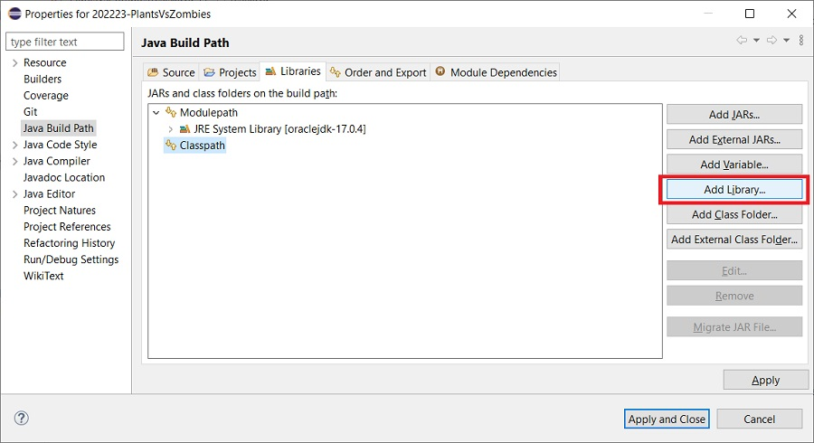
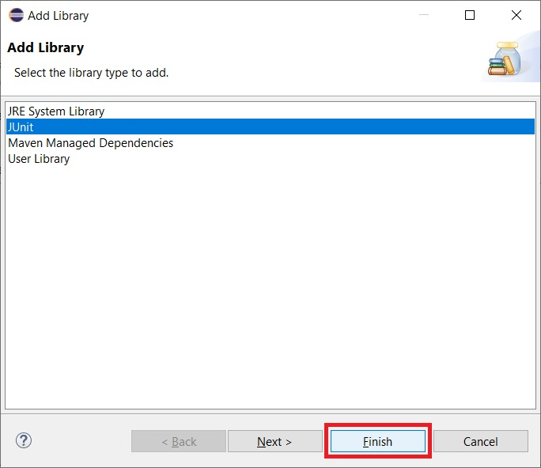
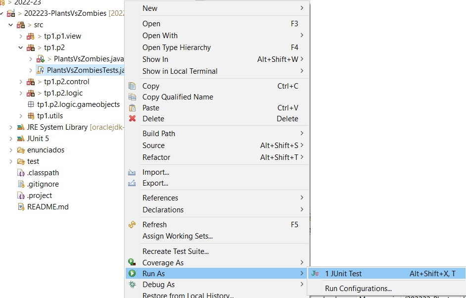
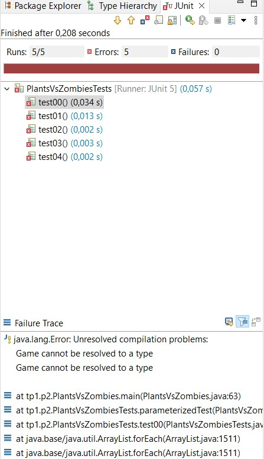
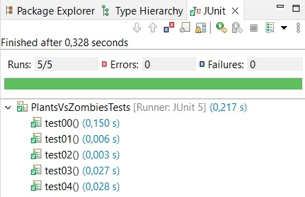

# Práctica 2 (Parte I): Plantas contra zombis _refactored_

**Entrega: Semana del 16 de noviembre**

**Objetivo:** Empleo de herencia y clases abstractas como forma de repartir las responsabilidades
de los objetos y generar abstracciones de más alto nivel. Uso de interfaces (además de para lo anterior) para ocultar
partes de la implementación a usuarios de esas abstracciones. Simplificación de la gestión de los comandos mediante
el uso del patrón `Command`.

**Preguntas Frecuentes**: Como es habitual que tengáis dudas (es normal) las iremos recopilando en
este [documento de preguntas frecuentes](../faq.md). Para saber los últimos cambios que se han
introducido [puedes consultar la historia del documento](https://github.com/informaticaucm-TPI/2627-PlantsVsZombies/commits/master/enunciados/faq.md).

<!-- TOC start -->

- [Práctica 2 (Parte I): Plantas contra zombis Refactored](#práctica-2-parte-i-plantas-contra-zombis-refactored)
  * [Introducción](#introducción)
  * [Refactorización de la solución de la práctica anterior](#refactorización-de-la-solución-de-la-práctica-anterior)
    + [Patrón Command](#patrón-command)
    + [La clase Game y sus diferentes usos](#la-clase-game-y-sus-diferentes-usos)
    + [Herencia y polimorfismo](#herencia-y-polimorfismo)
    + [`GameObjectContainer`](#gameobjectcontainer)
    + [Patrón Factory](#patrón-factory)
      - [Implementación](#implementación)
    + [GameItem y callbacks](#gameitem-y-callbacks)
  * [Pruebas](#práctica2-parte1-pruebas)
- [Práctica 2 (Parte II): Plantas contra zombis Extended](#práctica-2-parte-ii-plantas-contra-zombis-extended)
  - [Extensiones básicas del juego](#extensiones-básicas-del-juego)
    * [Incorporación de nuevos objetos de juego](#incorporación-de-nuevos-objetos-de-juego)
      + [CherryBomb plant](#cherrybomb-plant)
      + [Wall-Nut plant](#wall-nut-plant)
      + [BucketHead zombie](#buckethead-zombie)
      + [Sporty zombie](#sporty-zombie)
      + [Explosive zombie](#explosive-zombie)
    * [Comandos](#comandos)
      + [Comando Reset](#comando-reset)
      + [ListZombiesCommand](#listzombiescommand)
      + [AddPlantCheatCommand](#addplantcheatcommand)
      + [AddZombieCommand](#addzombiecommand)
  - [Cambiando la mecánica para conseguir *suncoins*](#cambiando-la-mecánica-para-conseguir-suncoins)
    * [Detalles de la mecánica](#detalles-de-la-mecánica)
    * [Implementación de la mecánica](#implementación-de-la-mecánica)
  - [La interfaz `GameAction` y las acciones `ExplosionAction`](#la-interfaz-gameaction-y-las-acciones-explosionaction)
  - [Opcional: Pinta la valla y los zombies fuera del tablero](#pinta-zombies-y-valla)
  - [Pruebas](#práctica2-parte2-pruebas)

<!-- TOC end -->
<!-- TOC --><a name="práctica-2-parte-i-plantas-contra-zombis-refactored"></a>

<!-- TOC --><a name="introducción"></a>

## Introducción

Esta práctica consiste, fundamentalmente, en aplicar los mecanismos que ofrece la POO para mejorar el código
desarrollado hasta ahora en la Práctica 1. En particular, en esta práctica incluiremos las siguientes mejoras:

- En la *Parte I* de la Práctica 2 refactorizaremos[^1] el código de la [Práctica 1](../practica1/practica1.md). Así lo
  preparamos para la *Parte II*. Para ello, modificaremos parte del controlador, distribuyendo su funcionalidad entre un
  conjunto de clases, mejor estructuradas, para facilitar las extensiones posteriores.

- El objetivo es que, al finalizar la refactorización, la práctica pase los mismos tests que los que se pasaron en la
  Práctica 1.

- Vamos a hacer uso de la herencia para reorganizar los objetos del juego. Hemos visto que hay mucho código repetido en
  los distintos tipos de objetos. Por ello, vamos a crear una jerarquía de clases que nos permita extender fácilmente la
  funcionalidad del juego.

- En la Parte II, una vez refactorizada la práctica, añadiremos nuevos objetos al juego y nuevos comandos de una forma
  segura, ordenada y fiable, gracias a la nueva estructura del código.

- La herencia también nos va a permitir redefinir cómo almacenamos la información del estado del juego. En la práctica
  anterior, al no usar herencia, debíamos tener una lista para cada conjunto de objetos. Sin embargo, en esta versión de
  la práctica, podremos usar una sola estructura de datos para todos los objetos de juego.

[^1]: Refactorizar consiste en cambiar la estructura del código (se supone que para mejorarlo) sin cambiar su
funcionalidad.

Todos los cambios comentados anteriormente se llevarán a cabo de forma progresiva. El objetivo principal es extender la
práctica de una manera robusta, preservando la funcionalidad en cada paso que hagamos y modificando el mínimo código
para ampliarla.

<!-- TOC --><a name="refactorización-de-la-solución-de-la-práctica-anterior"></a>

## Refactorización de la solución de la práctica anterior

<!-- TOC --><a name="patrón-command"></a>

### Patrón Command

En la práctica anterior, el usuario podía hacer varias acciones: añadir una planta, listar las plantas disponibles,
pedir ayuda, etc. El objetivo técnico de esta *Parte I* es poder añadir nuevas acciones sin tener que modificar código
ajeno a la nueva acción. Para ello, vamos a ver el patrón de diseño Command[^2], que es perfecto para este tipo de
estructuras.

La idea general es encapsular cada acción del usuario en su propia clase. Cada acción será un comando, de tal manera que
el comportamiento de un comando está completamente aislado del resto.

[^2]: Lo que vamos a ver en esta sección no es el patrón *Command* de manera rigurosa, sino una adaptación que hemos
hecho a las necesidades de la práctica.

En el patrón Command van a intervenir las siguientes entidades, que explicaremos en varios pasos según profundicemos en
los detalles:

- La clase `Command`. Es una clase abstracta que encapsula la funcionalidad común de todos los comandos concretos.
- Comandos concretos. Son las acciones del usuario: `AddPlantCommand`,`HelpCommand`, `ExitCommand`... Cada acción va a
  tener su propia clase. Cada comando tiene tres métodos básicos:
  - `matchCommand(String)`: es el método que comprueba si una acción introducida por teclado corresponde a la del
    comando.
  - `create(String[])`: es el método que crea una instancia del comando dados los parámetros proporcionados por el
    usuario.
  - `execute(GameModel, GameView)`: ejecuta la acción del comando, modificando el juego. Por qué aparece `GameModel` y no
    directamente `Game` se explicará más adelante. Si algo debe mostrarse en pantalla (un error, el tablero,...) se usará
    el otro parámetro de este método, de tipo `GameView`

- La clase `Controller`. El controlador en este caso va a ser muy reducido; como veremos más abajo, su funcionalidad va
  a ser delegada en los comandos concretos.

En la práctica anterior, para saber qué comando se ejecutaba, el **bucle de Juego** implementado mediante el método
`run()` del controlador contenía un switch (o una serie de if's anidados) cuyas opciones correspondían a los diferentes
comandos.

En la nueva versión, el método `run()` del controlador va a tener, más o menos, este aspecto. Tu código no tiene que ser
exactamente igual, pero lo importante es que veas que se asemeja a esta propuesta.

```java
while (!game.hasGameFinished() && !game.playerQuits()) {
   // 2. Ask for user action
    String[] words = prompt();
    Command command = Command.parse(words);
    if (command != null) {
        // 3-4. Game Action & Update. Draw if required
        command.execute(game, view);
    } else {
        view.showError(Messages.UNKNOWN_COMMAND));
    }
}
```

En el bucle, mientras el juego no termine, leemos una acción de la consola, la parseamos para obtener el comando
correspondiente, ejecutamos el comando y, si la ejecución es satisfactoria y ha cambiado el estado del juego, lo
repintamos. En otro caso, si el comando no es válido, mostramos un error.

En el bucle mostrado, la parte más importante es esta línea:

```java
Command command = Command.parse(words);
```

El punto clave es que el controlador sólo maneja comandos abstractos, por lo que no sabe qué comando concreto se ejecuta
y qué es lo que hace exactamente el comando. Este es el mecanismo que nos permite añadir fácilmente nuevos comandos
concretos.

**El método `parse(String[])`** es un método estático de la clase `Command`, encargado de encontrar qué comando concreto
corresponde a la entrada del usuario. Para ello la clase `Command` mantiene una lista `AVAILABLE_COMMANDS` con los
comandos disponibles. Este método recorre la lista de comandos para determinar, llamando al método
`matchCommand(String)` de cada comando, a cuál corresponde la entrada del usuario. Cuando lo encuentra, procesa los
parámetros (si los tiene), crea una instancia de ese mismo tipo de comando y lo devuelve al controlador.

El esqueleto del código es este:

```java
public abstract class Command {

  private static final List<Command> AVAILABLE_COMMANDS = Arrays.asList(
      new AddPlantCommand(),
      new ListPlantsCommand(),
      new ResetCommand(),
      new HelpCommand(),
      // ...
  );
  
  //...
  protected String name;
  protected String shortcut;
  protected String details;
  protected String help;
  //...


  public static Command parse(String[] commandWords) {
    //... 
  }

  //...
}
```

El `Controller`, después de recibir un `Command`, simplemente lo ejecutará pasándole el juego y la vista como parámetros.

Todos los comandos tienen una serie de **propiedades**: nombre, atajo, detalle, etc. Por ejemplo el comando concreto
`HelpCommand`:

```java
public class HelpCommand extends Command {
	
  public HelpCommand() {
    this.name = Messages.COMMAND_HELP_NAME;
    this.shortcut = Messages.COMMAND_HELP_SHORTCUT;
    this.details = Messages.COMMAND_HELP_DETAILS;
    this.help =  Messages.COMMAND_HELP_HELP;
  }

  @Override
  public void execute(GameModel model, GameView view) {
    // ...
  }
}
```

Como puede apreciarse, todos los comandos heredan de la clase `Command`. La clase `Command` es abstracta, por lo que son
los comandos concretos los que implementan sus funcionalidades específicas:

- El método `execute` realiza la acción sobre el *game* (realmente un `GameModel` que explicaremos más adelante)
  y una vista `view` (de tipo `GameView`, que ya teníamos de la práctica anterior). El método no devuelve nada,
  pues "ejecutar" un comando consiste simplemente en delegar en `game` algo (avanzar la partida, resetearla,...) y después,
  si es necesario, mostrar algo por la pantalla (es decir, ordenar a `view` que repite el tablero o muestre un mensaje de ayuda).
- El método `create(String[])` devuelve una instancia del comando concreto. Como cada comando procesa sus propios
  parámetros, este método devolverá `this` o creará una nueva instancia de la misma clase. En el caso de que los
  argumentos introducidos por el usuario no sean válidos para el comando, el método `create(String[])` devolverá `null`.

Sin embargo, hay métodos que pueden tener una implementación por defecto en `Command`, como `protected String getName()/getShortcut()` o 
`public String getDetails()/getHelp()`.

<!-- TOC --><a name="la-clase-game-y-sus-diferentes-usos"></a>

### La clase Game y sus diferentes usos

La clase `Game` se utiliza en diferentes partes de la aplicación: `Controller`, `GamePrinter`, etc. con diferentes
objetivos. Hasta ahora, si implementamos un nuevo método `Game` para que pueda ser utilizado en una parte específica de
la aplicación (en especial si es público), queda a disposición del resto de la aplicación.

Esta situación nos puede inducir a no tener una separación clara en la lógica de nuestra aplicación, ya que desde
cualquier parte de la aplicación podemos llamar a los métodos de `Game`. Para evitar este problema y limitar el
*acoplamiento* en nuestro código, podemos hacer uso de las interfaces de Java.

Mediante las interfaces de Java podemos declarar de manera específica las dependencias / necesidades de una parte de
nuestro código. En nuestro caso vamos a definir tres interfaces:

- `GameStatus`: Incluirá todos los métodos que necesita `GamePrinter` para "conocer" el estado del mundo y poder hacer
  su trabajo.

```java
public interface GameStatus {
  int getCycles();
  // ...
}
```

- `GameWorld`: Incluirá todos los métodos que necesitan los objetos del juego (plantas, zombies, etc.),
  para saber qué pasa en el *mundo del juego* e interactuar entre sí:

```java
public interface GameWorld {

  public static final int NUM_ROWS = 4;
  public static final int NUM_COLS = 8;

  boolean isEmpty(Position position);
  boolean isInsideBoard(Position position);

  // ...
}
```

- `GameModel` es la interfaz que permite alterar el estado de la partida (reiniciarla, actualizarla, ...) y es la que van
  a conocer los comandos del juego. Es el punto de entrada para las acciones del usuario:
```java
public interface GameModel {
  void reset();
  void update();
  void quit();
  // ...
}
```

Así, `Game` implementará estas tres interfaces diferenciadas:

```java
public class Game implements GameStatus, GameWorld, GameModel {

  public static final int INITIAL_COINS = 50;

  private boolean playerQuits;

  //...
}
```

<!-- TOC --><a name="herencia-y-polimorfismo"></a>

### Herencia y polimorfismo

Con el patrón *Command* se busca poder introducir nuevos comandos sin cambiar el código del controlador. De la misma
manera, queremos poder introducir nuevos objetos de juego sin tener que modificar el resto del código. La clave es que
`Game` no maneje objetos específicos, sino que maneje objetos de una entidad abstracta que vamos a llamar `GameObject`.
De esta entidad abstracta heredan el resto de objetos del juego. Como todos los elementos del juego van a ser
`GameObject`s, compartirán la mayoría de atributos y métodos, y cada uno de los objetos concretos será el encargado de
implementar su propio comportamiento.

Todos los `GameObject`s tienen una posición en el juego y una serie de métodos que llamamos durante cada ciclo del
juego, por ejemplo, cuando necesitan hacer algo propio de ese objeto en un momento concreto de su ciclo de vida:

- `onEnter()`: Se llama cuando el objeto entra en el juego.
- `update()`: Se llama en cada iteración del bucle de juego.
- `onExit()`: Se llama cuando el objeto sale del juego, desapareciendo.
- `isAlive()`: Es verdadero si el objeto sigue vivo, o falso, si hay que eliminarlo del juego.

Es normal que en objetos sencillos haya algunos de estos métodos vacíos o con funcionalidad trivial.

A continuación se muestra el esqueleto del código de la clase `GameObject`. Más adelante describimos el uso de la interfaz
`GameItem` utilizado para representar acciones y operaciones dentro de los elementos que se encuentran en el tablero de
juego.

```java
public abstract class GameObject implements GameItem {

  protected GameWorld game;
  protected Position position;

  GameObject(GameWorld game, Position p) {
    this.game = game;
    this.position = p;
  }

  public boolean isInPosition(Position other) {
    return this.position.equals(other);
  }

  public Position getPosition() { ... }

  abstract public String getIcon();

  abstract public String getDescription();

  abstract public boolean isAlive();

  abstract public void onEnter();

  abstract public void onExit();

  // ...
}
```

Este código lo tendrás que ir extendiendo y modificando a lo largo de las prácticas, para cada objeto del juego que
hereda de la clase `GameObject`.

<!-- TOC --><a name="gameobjectcontainer"></a>

### `GameObjectContainer`

En nuestra práctica queremos que el `Game` sea lo más simple posible y, aunque es la clase principal de nuestro
programa, su labor (responsabilidad) es coordinar al resto de las clases, y lo hace *delegando*.

La delegación consiste en lo siguiente: cuando están correctamente programados, los métodos de `Game` son muy pequeños y
lo que hacen es llamar a los métodos de otros objetos (es decir, colaboran con ellos) que son los que realmente hacen el trabajo.
Uno de los objetos en los que delega es `GameObjectContainer`.

El `GameObjectContainer` es el almacén de objetos del juego (para acortar escribiremos contenedor, o a veces simplemente `GOC`).
Es el encargado de actualizarlos, borrarlos, etc. Para el almacén podemos utilizar cualquier tipo de colección.
Nosotros por simplicidad vamos a usar un `ArrayList` de `GameObject`s cuya declaración es así:

```java
public class GameObjectContainer {

  private List<GameObject> gameObjects;

  public GameObjectContainer() {
    gameObjects = new ArrayList<>();
  }
//...
```

Es muy importante que los detalles de la implementación del `GameObjectContainer` sean privados. Eso permite cambiar el
tipo de colección sin tener que modificar código en el resto de la práctica.

En relación con la primera práctica, hay varios aspectos que van a cambiar en la estructura de esta práctica:

- Sólo tenemos un contenedor para todos los objetos concretos de juego.

- Desde el `Game` y el *contenedor* sólo manejamos abstracciones de los objetos, por lo que no podemos distinguir de qué
  clase son los objetos que están dentro del contenedor, una vez añadidos.

- Toda la lógica del juego estará en los objetos de juego. Cada clase concreta conoce sus detalles acerca de cómo se
  actualiza, qué pasa cuando ataca o es atacada, etc. En nuestro caso, también tenemos `ZombieManager` que seguirá
  teniendo la lógica de gestión de los zombies, pero los zombies estarán dentro del *contenedor*.

- Para asegurarnos de que el `Game` está bien programado, no podrá tener ninguna referencia a `GameObject`s concretos,
  solo podrá tener referencias al *contenedor*.

<!-- TOC --><a name="patrón-factory"></a>

### Patrón Factory

El patrón *Factory* es otro de los patrones más utilizados. Al igual que con el patrón *Command*, no vamos a estudiar
este patrón de manera rigurosa, sino que vamos a adaptarlo a nuestras necesidades concretas.

Una **factoría** es responsable de crear objetos **evitando exponer la lógica de creación al cliente**. En la primera
versión de la práctica, la lógica de creación de plantas está fuertemente acoplada con el controlador de la aplicación.
La forma de incorporar una nueva planta es la de incluir un nuevo bloque al `switch` o `if`'s que tenemos en el método `run`.
Seguramente tu código se parece a este:

```java
case "sunflower":
case "s":
  result = game.addSunflower(position);
  break;

case "peashooter":
case "p":
  result = game.addPeashooter(position);
  break;
```

En nuestra nueva versión queremos que se parezca a esto:

```java
Plant plant = PlantFactory.spawnPlant(this.plantName, game, position);
game.addPlant(plant);
```

Haciendo uso del patrón *Factory*, podemos extraer la lógica de creación a una clase dedicada exclusivamente a ello. De
esta manera añadir o eliminar una planta de la lista es tan sencillo como crear la clase correspondiente y modificar la
*Factory*. Así, los cambios en la lista ya no afectarán al controlador o al juego. Con esta propuesta, la lógica de
creación está desacoplada de la lógica del juego y puede evolucionar de forma independiente.

<!-- TOC --><a name="implementación"></a>

#### Implementación

En patrón *Factory* se combina muy bien con el patrón *Command*, ya que:

- Cuando ejecutamos un comando `add plant col row` podemos delegar la creación de la planta a la factoría.
- Cuando ejecutamos un comando `list` para saber cuáles son las plantas disponibles, podemos preguntar a la factoría qué
  `AVAILABLE_PLANTS` tiene. El siguiente código muestra el esqueleto de la factoría:

```java
public class PlantFactory {

  private static final List<Plant> AVAILABLE_PLANTS = Arrays.asList(
      // ...
  );


  public static Plant spawnPlant(String plantName, GameWorld game, Position position) {
    // ...
  }

  public static List<Plant> getAvailablePlants() {
    return Collections.unmodifiableList(AVAILABLE_PLANTS);
  }
  // ...
}
```

El método `getAvailablePlants()` será usado por el comando `ListPlantsCommand` para mostrar la información de las plantas
disponibles.

En la primera versión de la práctica sólo teníamos dos tipos de plantas y un tipo de zombi, pero nuestro objetivo es
poder extenderla de manera sencilla incorporando nuevos objetos de juego con diferentes características.

Aunque para la *parte I* no es necesario, también puedes crear una `ZombieFactory` para utilizarla en `ZombieManager` y
en un posible `AddZombieCommand`. Este comando te puede ser de utilidad para depurar, ya que además del comportamiento
aleatorio de la Práctica 1, también podrás colocar los zombis a tu antojo.


<!-- TOC --><a name="gameitem-y-callbacks"></a>

### GameItem y callbacks

Ya hemos resuelto la abstracción de los objetos, el almacenamiento y la creación. Ahora nos queda una cuestión muy
importante y quizás la más compleja. Para ello debes entender bien el problema.

Al usar la clase abstracta `GameObject`, una vez que un objeto se mete en el juego ya no sabemos qué clase de objeto es.
Podríamos saberlo usando `instanceof` o `getClass()`, pero eso está **terminantemente prohibido** en la práctica.

> [!IMPORTANT]
> Usar `instanceof`, ya sea de manera directa o indirecta (es decir, _disfrazando_ la funcionalidad con algún método
> del tipo `isZombie()` / `isPeashooter()`, ...) está **terminantemente prohibido** y supone la suspensión directa de la
> práctica

El problema es el siguiente: cuando un `Zombie` o un `Peashooter` quiere atacar algo no sabemos si en una casilla
adyacente hay una *planta* o `Zombie`.

Para resolver este problema vamos a hacer lo siguiente. En primer lugar, vamos a usar una interfaz `GameItem` para
encapsular los métodos relacionados con las interacciones / acciones dentro del juego. La clase `GameObject`
implementará dicha interfaz. El objetivo es que todos los objetos del juego deben tener la posibilidad de interactuar
entre ellos.

```java
public interface GameItem {
  boolean receiveZombieAttack(int damage);

  // ...
}
```

Las colisiones se podrían comprobar desde `Game`, desde los `GameObject`. Como `Zombie` es el único elemento que se
mueve, su método `update()` se podría implementar de la siguiente manera:

```java
public void update() {
  //...
  GameObject other = game.getGameObjectInPosition(position);
  if (other != null && other.getClass().getName() == "Sunflower") { // ó other.getClass() == Sunflower.class
    ((Sunflower) other).setAlive(false);
  }
  //...
}
```

Aunque te pueda parecer que el código es correcto (es más, funciona), es un **ejemplo de mala aplicación de la
programación orientada a objetos**.

Este ejemplo de código, por un lado, rompe la abstracción y encapsulación (ha sido necesario crear un mutador
`setAlive()`) y por otro, hace que el código sea poco mantenible porque tendremos que modificar el método `update()` de
`Zombie` para cada nuevo tipo de planta.

Otra opción que estaría igual de mal consiste en implementar métodos que simulen el comportamiento de
`Object.getClass()` o del operador `instanceof` **para todos los objetos del juego**, por ejemplo `isSunflower()`:

```java
public void update() {
  //...
  GameObject other = game.getGameObjectInPosition(position);
  if (other != null && other.isSunflower()) {
    ((Sunflower) other).setAlive(false);
  }
  //...
}
```

Ambos ejemplos muestran uno de los errores habituales de la programación orientada a objetos:

1. Reidentificar el tipo del objeto que estamos procesando y
2. utilizar una instrucción condicional para aplicar un comportamiento u otro;

Además, la clase `Zombie` está acumulando demasiadas responsabilidades que no debería tener.

Lo que queremos es que *la funcionalidad esté en los propios objetos de juego*, para que sea fácil extenderla y
modificarla sin afectar a otros objetos. Para ello vamos a usar la interfaz que veíamos arriba, de la siguiente manera:

```java
public void update() {
  //...
  GameObject other = game.getGameObjectInPosition(position);
  if (other != null) {
    other.receiveZombieAttack(this.damage);
  }
  //...
}
```

Todos los objetos implementan `receiveZombieAttack(int damage)`, y es precisamente en ese método donde debemos
implementar la lógica que gestiona un ataque zombie. Por ejemplo, el `receiveZombieAttack` de `Sunflower` le aplicaremos
el daño que le inflija el zombie, pero en la clase `Zombie` no hacemos nada.

Esta solución es un comienzo, ya que cada objeto gestiona las diferentes acciones del juego. El problema es que rompemos
la encapsulación al devolver un objeto `GameObject` de `Game`. Aunque la clase `GameObject` implemente la interfaz
`GameItem`, es recomendable, siempre que se pueda, interactuar utilizando los métodos definidos en la interfaz y no a
través de una clase que implemente dicha interfaz. Cabe recordar que en Java sólo tenemos disponible herencia simple,
**pero es posible implementar diferentes interfaces** que definen diferentes contratos dentro de la aplicación.

Para solucionar el problema debemos hacer que dos objetos sólo se comuniquen a través de la interfaz, que es una
abstracción o contrato entre ellos. Para ello vamos a usar la siguiente estructura:

```java
public void update() {
  //...
  GameItem item = game.getGameItemInPosition(position);
  if (item != null) {
    item.receiveZombieAttack(this.damage);
  }
  //...
}
```
o incluso una aproximación en la que en lugar de que la clase `Zombie` "manipule" el `GameObject`, le indique a la
referencia a `GameWorld` que tiene que atacar a un zombie. Esto tiene sentido porque así evitamos exponer los objetos
del juego a otros objetos, dar a conocer a `Zombie` que `GameWorld` tiene un método llamado `getGameObjectInPosition`
y además optamos por una aproximación más natural: en lugar de que `Zombie` recabe un montón
de información para realizar el ataque, simplemente le indica a la clase responsable de administrar el juego que lo haga:

```java
public void update() {
  //...
  game.plantAttack(this.position, this.damage);
  //...
}
```

La implementación de ese método es la que se ha visto más arriba:
```java
  // Game.java
  public boolean plantAttack(Position position, int damage) {
  GameItem item = this.getGameItemInPosition(position);
  if (item != null) {
    item.receiveZombieAttack(this.damage);
  }
}
```

El código es muy similar al anterior, pero usamos la *interfaz* como tipo de datos. Así ya **no rompemos la
encapsulación**, ya que sólo se conectan con abstracciones.

Por el momento, la interfaz `GameItem` es muy sencillo, pero en las extensiones tendremos que añadir nuevos métodos para
implementar interacciones más complejas.


<!-- TOC --><a name="práctica2-parte1-pruebas"></a>

## Pruebas

Recuerda que una vez terminada la refactorización, la práctica debe funcionar exactamente igual que en la versión
anterior y debe pasar los mismos tests, aunque tendremos muchas más clases. Así, conseguimos dejar preparada la
estructura para añadir fácilmente nuevos comandos y objetos de juego en la *Parte II*.

Ten en cuenta que los test, al igual que el código fuente de la aplicación, es algo vivo: en numerosas ocasiones
refactorizar el código principal implica refactorizar también los test. Piensa que los test unitarios están muy ligados
a la implementación de las clases. Dicho esto, tendrás que refactorizar _ligeramente_ los test heredados de la práctica 1.
No es un cambio trascendental, seguro que te das cuenta ;)

Para simplificar las pruebas, vamos a "abusar" del soporte de [JUnit](https://junit.org/) dentro de Eclipse para
facilitar nuestras pruebas de comparación de la salida de nuestro programa. JUnit es un marco de trabajo (aka _framework_) para poder
realizar pruebas automatizadas al código de tu aplicación Java. Es un estándar para pruebas unitarias en el mundo profesional,
y seguramente verás como utilizarlo en otras asignaturas de la carrera.

Antes de poder ejecutar las pruebas que incluye, tenemos que añadir JUnit a nuestro proyecto. Para ello, tenemos que ir
a las propiedades del proyecto *Project > Properties*, seleccionamos *Java Build Path* y vamos a la pestaña *Libraries*.
Allí pulsamos en el botón **Add Library...**



En la nueva ventana seleccionamos *JUnit* y pulsamos en el botón *Finish*



Al volver a la ventana de las propiedades del proyecto, pulsamos en el botón *Aply and Close*.

Si lo hemos configurado correctamente, al pulsar con el botón derecho del ratón sobre el fichero
`PlatsVsZombiesTests.java` e ir al menú *Run As*, debería de aparecer la opción **JUnit Test**.



Si ejecutamos las pruebas se mostrará una vista en Eclipse donde podremos ver el resultado de las pruebas, lanzar las
que hayan fallado de manera individualizada o todas a la vez. **Recuerda** que utilizamos las pruebas JUnit simplemente
para comparar la salida de tu programa con la salida esperada. Si quieres ver el detalle tendrás que aplicar el mismo
procedimiento que en la Práctica 1.






<!-- TOC --><a name="práctica-2-parte-ii-plantas-contra-zombis-extended"></a>

# Práctica 2 (Parte II): Plantas contra zombis _extended_

Antes de comenzar recordad la **advertencia**:

> La falta de encapsulación, el uso de métodos que devuelvan listas, y el uso de `instanceof` o `getClass()` tiene como
> consecuencia un **suspenso directo** en la práctica. Es incluso peor implementar un `instanceof` casero, por ejemplo
> así: cada subclase de la clase `GameObject` contiene un conjunto de métodos `esX`, uno por cada subclase X de
`GameObject`; el método `esX` de la clase X devuelve `true` y los demás métodos `esX` de la clase X devuelven `false`.


**NOTA:** Te recomendamos que leas completamente el enunciado antes de ponerte a implementar la funcionalidad
solicitada. Primero explicamos las nuevas funcionalidades que solicitamos y posteriormente proporcionamos algunos
detalles acerca de cómo puedes implementar estas funcionalidades.

<!-- TOC --><a name="extensiones-básicas-del-juego"></a>

# Extensiones básicas del juego

<!-- TOC --><a name="incorporación-de-nuevos-objetos-de-juego"></a>

## Incorporación de nuevos objetos de juego

Ahora que tenemos nuestra factoría y hemos utilizado herencia para generalizar los objetos de juego va a ser muy
sencillo extender el juego con nuevas plantas y zombis. De esta forma, vamos a incluir las siguientes plantas:

- `CherryBomb`
- `WallNut`

En cuanto a los zombies vamos a añadir los siguientes:

- `BucketHead`
- `Sporty`
- `ExplosiveZombie`

Los tres nuevos zombis ejercen el mismo daño que el zombi común de la primera práctica. Los diferentes tipos de zombis
aparecen con la misma probabilidad.

Para hacer estos cambios organiza tu jerarquía de objetos de juego para que tengan como base `GameObject`, del que heredan
`Plant` y `Zombie`, de los cuales heredan las clases concretas de plantas y zombies. Mientras implementes esta nueva
jerarquía, analiza qué clases de tu jerarquía deberían de ser clases abstractas.

Si has planteado bien la lista de objetos y el juego, no deberías tener que hacer ningún cambio importante, lo único que
tendrás que hacer es crear las clases y registrar los nuevos objetos en sus respectivas factorías.

De todas formas, ten en cuenta que el código es algo vivo, y no sería extraño que a medida que fueses incorporando
nuevos objetos o funcionalidades al juego te des cuenta de que hay más código que puedes simplificar, escribir de forma
más sencilla o lógica que se mueva de una clase más específica a una más general. No tengas miedo a ir mejorando
tu propio código de forma iterativa. Abraza el cambio :)

Así quedará nuestra lista de plantas.

```
Command > l

[DEBUG] Executing: l

[S]unflower: cost='20' suncoins, damage='0', endurance='1'
[P]eashooter: cost='50' suncoins, damage='1', endurance='3'
[W]all-[N]ut: cost='50' suncoins, damage='0', endurance='10'
[C]herry-Bomb: cost='50' suncoins, damage='10', endurance='2'
```

Así es como veremos la pantalla con los nuevos tipos de objetos.

```
Number of cycles: 20
Sun coins: 130
Remaining zombies: 5
     ────────────── ────────────── ────────────── ────────────── ────────────── ────────────── ────────────── ────────────── 
    |              |              |              |              |              |     Z[05]    |              |              |              
     ────────────── ────────────── ────────────── ────────────── ────────────── ────────────── ────────────── ────────────── 
    |              |              |              |              |              |              |              |    Bz[08]    |              
     ────────────── ────────────── ────────────── ────────────── ────────────── ────────────── ────────────── ────────────── 
    |              |              |              |              |              |    Sz[02]    |              |              |              
     ────────────── ────────────── ────────────── ────────────── ────────────── ────────────── ────────────── ────────────── 
    |              |              |              |              |              |    Ez[05]    |              |              |              
     ────────────── ────────────── ────────────── ────────────── ────────────── ────────────── ────────────── ────────────── 
```

<!-- TOC --><a name="cherrybomb-plant"></a>

### CherryBomb plant

Es una planta que explota y quita *10* puntos de daño a todos los zombis que están a su alrededor (a distancia de 1
casilla). Una vez que explota, la planta muere. La explosión ocurre dos ciclos después de ser plantada. Los zombis
también se pueden comer a la planta, que tiene resistencia *2*. Su coste es *50* suncoins.

> NOTA: La planta tiene que estar viva para poder explotar.

Su representación será una `c` minúscula, que pasará a ser mayúscula `C` justo el ciclo anterior a explotar.

<!-- TOC --><a name="wall-nut-plant"></a>

### Wall-Nut plant

Es una planta que sirve como barrera. Tiene coste *50* suncoins y resistencia *10*. Esta planta no produce ningún daño.

Su representación será `WN`.

<!-- TOC --><a name="buckethead-zombie"></a>

### BucketHead zombie

Es un zombie más lento pero más resistente, porque lleva un cubo protegiendo su cabeza.
Camina un paso cada *4* ciclos y tiene resistencia *8*.

Su representación será `Bz`.

<!-- TOC --><a name="sporty-zombie"></a>

### Sporty zombie

Es un zombie más rápido pero menos resistente. Camina un paso cada ciclo y tiene resistencia *2*.

Su representación será `Sz`.

<!-- TOC --><a name="explosive-zombie"></a>

### Explosive zombie

Tiene la misma velocidad y resistencia que un zombie básico, pero si una planta lo mata explota haciendo *3* de daño a
todas las plantas que tiene a su alrededor.

Su representación será `Ez`.

<!-- TOC --><a name="comandos"></a>

## Comandos

Ahora, vamos a introducir algunos comandos adicionales para *hacer trampas* en el juego, pero que nos permitirán realizar las
pruebas de la aplicación de manera más sencilla.

Al terminar de añadir todos los comandos, si solicitamos la ayuda de la aplicación se deberá generar la siguiente
salida:

```
Command > h

[DEBUG] Executing: h

Available commands:
[a]dd <plant> <col> <row>: add a plant in position (col, row)
[a]dd[Z]ombie <zombie> <col> <row>: add a zombie in position (col, row)
[C]heat[P]lant <plant> <col> <row>: add a plant in position (col, row) without consuming suncoins
[l]ist: print the list of available plants
[l]ist[Z]ombies: print the list of available zombies
[r]eset [<level> <seed>]: start a new game (if level and seed are both provided, they are used to initialize the game)
[h]elp: print this help message
[e]xit: terminate the program
[n]one | "": skips cycle
```


<!-- TOC --><a name="comando-reset"></a>

### Reset

En primer lugar, vamos a modificar ligeramente el comportamiento del comando reset de la Práctica 1 con el objetivo de facilitar las
pruebas, de modo que sea posible cambiar el nivel y la semilla de juego sin tener que parar y volver a arrancar el
juego.

El `ResetCommand` debe ser suficientemente flexible como para o bien recibir 0 parámetros y, por tanto, utilizar el
nivel y semilla que se venían utilizando, o bien recibir 2 parámetros (mismo tipo y orden que
en la línea de comandos) que se utilizarán para reiniciar la partida.

Ten en cuenta que al resetear el juego, también se debe reiniciar la instancia de `Random` que se utiliza para generar
la partida.

Además, otro efecto colateral de este cambio es que la ayuda del comando reset cambia ligeramente (para reflejar que puede
aceptar dos argumentos opcionales).

<!-- TOC --><a name="listzombiescommand"></a>

### ListZombiesCommand

En concreto, el comando `ListZombiesCommand` comando lista los zombies disponibles en el juego.

```
Command > lz

[DEBUG] Executing: lz

Available zombies:
Zombie: speed='2', damage='1', endurance='5'
BucketHead Zombie: speed='4', damage='1', endurance='8'
Sporty Zombie: speed='1', damage='1', endurance='2'
Explosive Zombie: speed='2', damage='1', endurance='5'
```

<!-- TOC --><a name="addplantcheatcommand"></a>

### AddPlantCheatCommand

Este comando es similar a `AddPlantCommand`, es decir, permite añadir una planta al juego, pero en este caso no se
consumen suncoins.

Este comando **hace que se actualice el juego** (al igual que cuando se añade una planta).

<!-- TOC --><a name="addzombiecommand"></a>

### AddZombieCommand

Este comando permite añadir un zombie al juego en una casilla que se encuentre libre dentro del terreno de juego.

Este comando **hace que se actualice el juego** (al igual que cuando se añade una planta).

<!-- TOC --><a name="cambiando-la-mecánica-para-conseguir-suncoins"></a>

# Cambiando la mecánica para conseguir *suncoins*

El siguiente cambio afecta a más partes del juego, por lo que es más delicado. Hasta ahora los `Sunflower`s actualizaban
el número de *suncoins* automáticamente pasado un número de ciclos concretos. Vamos a cambiar esta mecánica para que se
parezca más a la mecánica del juego original, es decir, ahora los `Sunflower`s van a generar *soles* que el jugador va a
tener que recoger. Cuando el jugador recoge un *sol*, este le proporcionará *suncoins*.

Vamos a representar los soles como un nuevo tipo de objeto mediante la clase `Sun`. Y el jugador tendrá que coger los
`Sun`s con el nuevo comando `catch col row`. La lista de comandos disponibles quedará del siguiente modo:

```
Command > h

[DEBUG] Executing: h

Available commands:
[a]dd <plant> <col> <row>: add a plant in position (col, row)
[a]dd[Z]ombie <zombie> <col> <row>: add a zombie in position (col, row)
[C]heat[P]lant <plant> <col> <row>: add a plant in position (col, row) without consuming suncoins
[C]atch <col> <row>: catch a sun, if possible, in position (col, row)
[l]ist: print the list of available plants
[l]ist[Z]ombies: print the list of available zombies
[r]eset [<level> <seed>]: start a new game (if level and seed are both provided, they are used to initialize the game)
[h]elp: print this help message
[e]xit: terminate the program
[n]one | "": skips cycle
```

<!-- TOC --><a name="detalles-de-la-mecánica"></a>

## Detalles de la mecánica

El comportamiento completo de la mecánica de juego es el siguiente:

- Cada `Sunflower` en vez de añadir *suncoins* directamente al jugador cuando pasan 3 ciclos, añadirá un `Sun` en una
  casilla aleatoria.

- Además, aleatoriamente cada *5* ciclos se genera un sun en una posición aleatoria del tablero.

- Puede haber más de un sol en una casilla. Si hay más de uno, sólo se pinta 1.

- Sí puede haber una planta o un zombie en la misma casilla de un sol.

- Los soles estarán disponibles en el juego durante *10* ciclos. Si el usuario no coge los soles, estos desaparecerán.

- El usuario tiene que coger los soles; solo se puede coger soles (si hay más de uno en la misma casilla), una vez por
  turno / ciclo. Cada sol suma *10* suncoins como en la práctica anterior.

> Aclaración: El `GamePrinter` que te proporcionamos como plantilla ya está ajustado para que en cada casilla se puedan
> pintar 1 zombie o 1 planta y 1 sol. Si hay **más de un sol** en una casilla **sólo se pintará 1** pero **se recogerán
todos** con el comando `catch`.

Los soles se representarán con el símbolo `*[XX]` (donde XX son los ciclos que le quedan antes de desaparecer). Como
puede haber una planta o un zombie en la misma casilla de un sol, e incluso los zombies pueden caminar por encima de los
soles, a la hora de pintar el tablero se tendrá que generar de la siguiente manera, concatenando el símbolo del sol con
el del objeto de juego que haya en la casilla:

```
Number of cycles: 28
Sun coins: 10
Remaining zombies: 2
Generated suns: 18
Caught suns: 0

     ────────────── ────────────── ────────────── ────────────── ────────────── ────────────── ────────────── ────────────── 
    |  S[01] *[02] |     *[02]    |              |              |              |  *[06]Sz[02] |              |              |              
     ────────────── ────────────── ────────────── ────────────── ────────────── ────────────── ────────────── ────────────── 
    |     S[01]    |              |              |              |              |              |              |     *[05]    |              
     ────────────── ────────────── ────────────── ────────────── ────────────── ────────────── ────────────── ────────────── 
    |              |              |              |              |              |     *[05]    |              |              |              
     ────────────── ────────────── ────────────── ────────────── ────────────── ────────────── ────────────── ────────────── 
    |              |     *[08]    |              |              |              |              |     *[08]    |              |              
     ────────────── ────────────── ────────────── ────────────── ────────────── ────────────── ────────────── ────────────── 
```

<!-- TOC --><a name="implementación-de-la-mecánica"></a>

## Implementación de la mecánica

Para implementar esta parte vamos a proceder con los siguientes cambios:

- Vamos a añadir una clase `Sun`. Recuerda que los soles sólo estarán como mucho *10* ciclos en el juego.

- Los `Sunflowers`, en lugar de actualizar el número de *suncoins*, generarán un nuevo `Sun`.

- Crearemos una clase `SunsManager` que se encargará de centralizar la generación de soles aleatorios. Esta clase es
  similar a `ZombiesManager`. Esta acción sólo se realiza 1 vez por turno / ciclo.

- Actualiza `Game` para delegar en `SunsManager` la generación aleatoria de soles.

- Crearemos el comando `CatchCommand` que delegará en el juego para intentar coger los soles. Recuerda que esta acción
  sólo se puede realizar 1 vez por turno / ciclo.

- Actualiza la información del estado del juego para saber el número de `Sun`s generados y los que el jugador ha cogido.
  Los soles generados son aquellos que se han añadido al juego (se hayan cogido o no) y los soles cogidos son aquellos
  que el usuario ha cogido realmente con el comando `catch col row`

> **NOTA**: Ten en cuenta que al añadir `Sun`s al `GameObjectContainer`, estos van a recibir inmediatamente
`update()`. Ajusta su tiempo de vida para que al añadirlo al juego realmente estén *10* ciclos presentes.

Siguiendo el mismo razonamiento que para los soles, necesitamos algo que nos permita controlar si ya
se ha ejecutado un comando `CatchCommand` en un turno / ciclo concreto.

> NOTA: Este comando *no actualiza* el juego.

El `Game` debe saber si ya se cogieron soles en el ciclo presente, y notificar de alguna forma al `CatchCommand` que no
puede ejecutarse otra vez si ya se cogieron soles.

<!-- TOC --><a name="detalles-de-implementación"></a>

<!-- TOC --><a name="la-interfaz-gameaction-y-las-acciones-explosionaction"></a>

## La interfaz `GameAction` y las acciones `ExplosionAction`

La introducción de los nuevos objetos `CherryBomb` y `ExplosiveZombie` introduce una complicación adicional en el juego
y es que **es necesario gestionar explosiones encadenadas**. Esto es, si una `CherryBomb` explota matando a un
`ExplosiveZombie` este a su vez también explota, por lo que puede matar a alguna planta que tenga a su alcance. A
continuación mostramos el escenario descrito.

```
Number of cycles: 28
Sun coins: 130
Remaining zombies: 5
   
     ────────────── ────────────── ────────────── ────────────── ────────────── ────────────── ────────────── ────────────── 
    |              |              |              |              |              |              |              |              |              
     ────────────── ────────────── ────────────── ────────────── ────────────── ────────────── ────────────── ────────────── 
    |              |              |              |              |              |              |              |              |              
     ────────────── ────────────── ────────────── ────────────── ────────────── ────────────── ────────────── ────────────── 
    |              |              |              |              |              |     C[02]    |              |              |              
     ────────────── ────────────── ────────────── ────────────── ────────────── ────────────── ────────────── ────────────── 
    |              |              |              |              |     WN[04]   |    Ez[05]    |              |              |              
     ────────────── ────────────── ────────────── ────────────── ────────────── ────────────── ────────────── ────────────── 
```

Para poder implementar este comportamiento tenemos que realizar dos cambios importantes en el juego:

- Eliminar los objetos muertos en `Game#update()` 1 o más veces. Es decir, hay que eliminar objetos muertos mientras
  haya eliminado algún objeto en la pasada anterior.
- Ejecutar acciones de juego como resultado de haber matado / o salir del juego uno de los objetos.

Si no tenemos cuidado a la hora de diseñar e implementar esta funcionalidad, complicaríamos en exceso el código de
`Game` y `GameObjectContainer`. Además, es probable que repartiéramos la responsabilidad de la actualización del juego
entre varias clases.

Para flexibilizar el diseño vamos a introducir la interfaz `GameAction`:

```java
package tp1.pvz.logic.actions;

public interface GameAction {
  void execute(GameWorld game);
}
```

Esta interfaz nos permitirá representar acciones de juego, como una explosión. En nuestro caso tendremos que implementar
la clase `ExplosionAction` que nos permitirá implementar el comportamiento de atacar un zombie o una planta (dependiendo
de qué objeto haya causado la explosión) en las casillas adyacentes a una posición concreta. En el siguiente escenario,
como resultado de explotar la `CherryBomb` de la casilla (5, 2) se ven afectadas las casillas marcadas con **X**. Como
resultado de la explosión, también explotará el `ExplosiveZombie` de (5, 3) afectando a las casillas marcadas con **Y**.

```
     ────────────── ────────────── ────────────── ────────────── ────────────── ────────────── ────────────── ────────────── 
    |              |              |              |              |              |              |              |              |              
     ────────────── ────────────── ────────────── ────────────── ────────────── ────────────── ────────────── ────────────── 
    |              |              |              |              |      X       |      X       |      X       |              |              
     ────────────── ────────────── ────────────── ────────────── ────────────── ────────────── ────────────── ────────────── 
    |              |              |              |              |      X Y     |     C[02] Y  |      X Y     |              |              
     ────────────── ────────────── ────────────── ────────────── ────────────── ────────────── ────────────── ────────────── 
    |              |              |              |              |   WN[04] X Y |    Ez[05] X  |      X Y     |              |              
     ────────────── ────────────── ────────────── ────────────── ────────────── ────────────── ────────────── ────────────── 
```

Para lograr este comportamiento vamos a implementar una pila de `GameAction`s que se ejecutaran al comienzo y al final
de cada ciclo del juego. De este modo, cuando un objeto de juego va a explotar, en vez de ejecutarse inmediatamente, se
apila una instancia de `ExplosionAction` que se ejecutará cuando sea necesario. Como resultado de esa ejecución, es
posible que otros objetos apilen otros efectos, que a su vez serán ejecutados una vez finalizada la ejecución del efecto
actual. Como resultado adicional, la pila de acciones de juego nos permite definir un orden consistente en la ejecución
de las acciones que nos facilita la depuración de la aplicación.

Pese a que existe la clase `java.util.Stack` [su propia documentación](https://docs.oracle.com/en/java/javase/25/docs/api/java.base/java/util/Stack.html)
nos indica que es más recomendable utilizar una clase que
implemente la interfaz `java.util.Deque` por lo que en nuestro caso hemos decidido utilizar la clase
`java.util.ArrayDeque`.

A continuación mostramos un extracto del código necesario para poder gestionar las `GameAction` dentro de `Game`.

```java
// Game.java

private Deque<GameAction> actions;

// ...

public void reset(Level level, long seed) {
  // ...
  this.actions = new ArrayDeque<>();
}

public void update() {

  // 1. Execute pending actions
  executePendingActions();

  // 2. Execute game Actions

  // 3. Game object updates

  // 4. & 5. Remove dead and execute pending actions
  boolean deadRemoved = true;
  while (deadRemoved || arePendingActionsLeft()) {
    // 4. Remove dead
    deadRemoved = this.container.removeDead();

    // 5. execute pending actions
    executePendingActions();
  }

  this.cycle++;
}

public void pushAction(GameAction gameAction) {
  this.actions.addLast(gameAction);
}

private void executePendingActions() {
  while (!this.actions.isEmpty()) {
    GameAction action = this.actions.removeLast();
    action.execute(this);
  }
}

private boolean arePendingActionsLeft() {
  return !this.actions.isEmpty();
}
```

<!-- TOC --><a name="pinta-zombies-y-valla"></a>

## Opcional: Pinta la valla y los zombies fuera del tablero

Durante la práctica I no podíamos ver a los zombies que, pese a estar en la partida, aún no habían entrado al tablero.
Queda a vuestra disposición modificar la función `public void showGame()` de `GamePrinter` para lograrlo. A continuación se
incluye un ejemplo de ejecución con esta modificación estética:

```
Level: EASY
Random generator initialized with seed: 25
Number of cycles: 0
Sun coins: 50
Remaining zombies: 3
Generated suns: 0
Caught suns: 0

   ──────────── ──────────── ──────────── ──────────── ──────────── ──────────── ──────────── ──────────── 
  |            |            |            |            |            |            |            |            || 
   ──────────── ──────────── ──────────── ──────────── ──────────── ──────────── ──────────── ──────────── 
  |            |            |            |            |            |            |            |            || 
   ──────────── ──────────── ──────────── ──────────── ──────────── ──────────── ──────────── ──────────── 
  |            |            |            |            |            |            |            |            || 
   ──────────── ──────────── ──────────── ──────────── ──────────── ──────────── ──────────── ──────────── 
  |            |            |            |            |            |            |            |            || 
   ──────────── ──────────── ──────────── ──────────── ──────────── ──────────── ──────────── ──────────── 
   
   ...
   
Number of cycles: 1
Sun coins: 50
Remaining zombies: 2
Generated suns: 0
Caught suns: 0

   ──────────── ──────────── ──────────── ──────────── ──────────── ──────────── ──────────── ──────────── 
  |            |            |            |            |            |            |            |            || 
   ──────────── ──────────── ──────────── ──────────── ──────────── ──────────── ──────────── ──────────── 
  |            |            |            |            |            |            |            |            || 
   ──────────── ──────────── ──────────── ──────────── ──────────── ──────────── ──────────── ──────────── 
  |            |            |            |            |            |            |            |            || Bz[08]
   ──────────── ──────────── ──────────── ──────────── ──────────── ──────────── ──────────── ──────────── 
  |            |            |            |            |            |            |            |            || 
   ──────────── ──────────── ──────────── ──────────── ──────────── ──────────── ──────────── ──────────── 
   
   ...

Number of cycles: 2 - 3
Sun coins: 50
Remaining zombies: 1
Generated suns: 0
Caught suns: 0

   ──────────── ──────────── ──────────── ──────────── ──────────── ──────────── ──────────── ──────────── 
  |            |            |            |            |            |            |            |            || 
   ──────────── ──────────── ──────────── ──────────── ──────────── ──────────── ──────────── ──────────── 
  |            |            |            |            |            |            |            |            || 
   ──────────── ──────────── ──────────── ──────────── ──────────── ──────────── ──────────── ──────────── 
  |            |            |            |            |            |            |            |            || Bz[08] Z[05]
   ──────────── ──────────── ──────────── ──────────── ──────────── ──────────── ──────────── ──────────── 
  |            |            |            |            |            |            |            |            || 
   ──────────── ──────────── ──────────── ──────────── ──────────── ──────────── ──────────── ────────────    
   
   ...
   
Number of cycles: 4
Sun coins: 50
Remaining zombies: 1
Generated suns: 0
Caught suns: 0

   ──────────── ──────────── ──────────── ──────────── ──────────── ──────────── ──────────── ──────────── 
  |            |            |            |            |            |            |            |            || 
   ──────────── ──────────── ──────────── ──────────── ──────────── ──────────── ──────────── ──────────── 
  |            |            |            |            |            |            |            |            || 
   ──────────── ──────────── ──────────── ──────────── ──────────── ──────────── ──────────── ──────────── 
  |            |            |            |            |            |            |            |    Z[05]   || Bz[08]
   ──────────── ──────────── ──────────── ──────────── ──────────── ──────────── ──────────── ──────────── 
  |            |            |            |            |            |            |            |            || 
   ──────────── ──────────── ──────────── ──────────── ──────────── ──────────── ──────────── ──────────── 
   
   ...
   
Number of cycles: 10
Sun coins: 50
Remaining zombies: 0
Generated suns: 1
Caught suns: 0

   ──────────── ──────────── ──────────── ──────────── ──────────── ──────────── ──────────── ──────────── 
  |    *[06]   |            |            |            |            |            |            |            || Sz[02]
   ──────────── ──────────── ──────────── ──────────── ──────────── ──────────── ──────────── ──────────── 
  |            |            |            |            |            |            |            |            || 
   ──────────── ──────────── ──────────── ──────────── ──────────── ──────────── ──────────── ──────────── 
  |            |            |            |            |    Z[05]   |            |            |   Bz[08]   || 
   ──────────── ──────────── ──────────── ──────────── ──────────── ──────────── ──────────── ──────────── 
  |            |            |            |            |            |            |            |            || 
   ──────────── ──────────── ──────────── ──────────── ──────────── ──────────── ──────────── ──────────── 
```

<!-- TOC --><a name="práctica2-parte2-pruebas"></a>

## Pruebas

Durante la parte I de la práctica, fruto del refactor que hemos hecho, va a ser necesario:
* Renombrar algunos métodos en las clases de prueba de los objetos del juego (`PeashooterTest`, `SunflowerTest` y
  `ZombieTest`). Basta con hacer un "buscar y reemplazar". Esto es algo normal y natural en el mundo del software: los test,
  que no dejan de ser código que acompaña al código principal, evolucionan a medida que lo hace este.
* Deben seguir funcionando igual que cuando se entregó la práctica I. Hemos refactorizado el código (quizá cambiando ligeramente
  el nombre de algunos métodos, lo que provoca el renombrado descrito en el punto anterior), pero la funcionalidad no ha cambiado.
  Si algún test que no fallaba ahora lo hace, algo hemos _roto_ por el camino.

Ahora bien, en la parte dos sí hemos hecho cambios que afectan a la lógica del juego: hay nuevos comandos, nuevos tipos
de plantas y zombies, etc. Por tanto, es necesario utilizar nuevos test. Estos os los proporcionamos pero tened en cuenta
que no deberíais incorporarlos a vuestro proyecto hasta que la parte I esté completamente finalizada y comencéis a trabajar
en la parte II.
